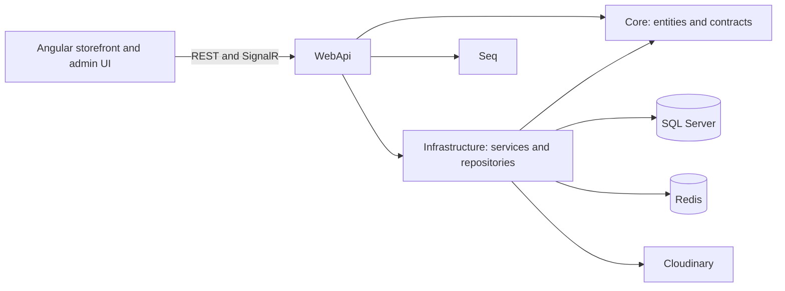

# Custom Builds

Configure custom controllers and mechanical keyboards, track orders and chat with support.

[](https://dotnet.microsoft.com/) [](https://angular.dev/) [](compose.yaml)

## Demo and screenshots

<!-- TODO: add public live demo URL -->
Hosted demo pending.

Capture these views using demo data:

- the keyboard or controller configurator with a live price breakdown
  <!-- TODO: add screenshot of the keyboard or controller configurator with a live price breakdown -->
- a customer order timeline
  <!-- TODO: add screenshot of a customer order timeline -->
- the admin revenue and low-stock dashboard
  <!-- TODO: add screenshot of the admin revenue and low-stock dashboard -->
- a support conversation with the typing indicator
  <!-- TODO: add screenshot of a support conversation with the typing indicator -->

## Key features

**Shopping**

- Choose parts and modifications for a controller or mechanical keyboard and see the total update as you build.
- Review configured items in a cart and place an order.
- Follow order status in the customer account.
- Ask for help through a live support chat with typing indicators.

**Store operations**

- Maintain parts, sections, modifications and product listings.
- Review revenue and low-stock information in the admin dashboard.
- Manage order status and answer customer conversations.

## Architecture



The API handles authorization, HTTP results and chat connections. Core defines
the product model and service contracts. Infrastructure owns database access and
cache implementations. Keeping those concerns apart lets the configurator UI
evolve independently of persistence and order-state rules.

## Design decisions

### Catalog caching

- **Problem** · The configurator repeatedly reads similar part, section and modification data.
- **Solution** · Cached implementations wrap those catalog services and use Redis for reusable reads.
- **Trade-off** · Catalog edits need invalidation and cached reads add an external dependency.

### Support chat

- **Problem** · Customers and support staff need new messages and presence cues during a conversation.
- **Solution** · A SignalR chat hub exposes messaging, chat groups and typing events; the message API loads history.
- **Trade-off** · Transient typing events can be missed during a disconnect; the UI can reload history.

### Authentication and session renewal

- **Problem** · A customer should stay signed in across normal browsing and ordering.
- **Solution** · ASP.NET Identity and JWT cookies back the session. The frontend interceptor refreshes an expired session, and the API checks roles on admin routes. The refresh operation issues a new token pair.
- **Trade-off** · Secure, strict cookies require aligned HTTPS origins in development.

### Order and configuration integrity

- **Problem** · A request can update related records, and catalog items have mutually exclusive association rules.
- **Solution** · A transactional action filter wraps selected writes; model validation checks exclusive relationships.
- **Trade-off** · Rules enforced in application validation need equivalent safeguards for writes that bypass the API.

## Tech stack

| Area | Technology |
| --- | --- |
| Backend | ASP.NET Core .NET 10, EF Core 10, Result pattern |
| Frontend | Angular 21, signals, RxJS, Tailwind CSS 4 |
| Data and caching | SQL Server 2022, Redis 7, Cloudinary |
| Real-time | SignalR support chat |
| Security | ASP.NET Core Identity, JWT cookies, admin authorization |
| Testing | Angular unit-test builder with Vitest |
| DevOps | Docker Compose, Nginx, Serilog and Seq |

## Getting started

Use Docker with Compose, the .NET 10 SDK and EF Core CLI 10.x for the first
database migration. Run each stack separately if it uses the same host ports.

```bash
git clone https://github.com/FerasAbukweik/Custom_Builds.git
cd Custom_Builds
```

Create a local `.env` in the repository root. Supply these values before
starting Compose.

| Variable | Local value |
| --- | --- |
| `DB_NAME` | A database name you choose |
| `SA_PASSWORD` | A strong SQL Server password |
| `JWT_KEY` | A generated signing key |
| `SeqPassword` | A new Seq admin password |
| `CloudName`, `ApiKey`, `ApiSecret` | Your Cloudinary settings |

Set `CertPassword` in `.env` and place a trusted localhost PFX at
`https/aspnetapp.pfx`. The clone does not include that PFX. For example:

```bash
mkdir -p https
dotnet dev-certs https -ep https/aspnetapp.pfx -p "$CertPassword"
dotnet dev-certs https --trust
```

Set the shell variable `CertPassword` to the same local value before exporting.
Compose also mounts the Nginx PEM certificate and key from `FrontEnd/ssl/`.

Before running the EF command, set the host environment variable
`ConnectionStrings__Default` to your local SQL Server connection
(`localhost,1433`, user `sa`, and the database name and password from `.env`).
Compose reads `.env` for containers. The host EF CLI reads its own environment.
Install `dotnet-ef` 10.x if it is missing.

```bash
docker compose up -d --wait custom-builds-sqlserver custom-builds-redis
dotnet ef database update --project src/Custom_Builds.Infrastructure --startup-project src/Custom_Builds.WebApi
docker compose up -d --build
```

| Service | Address |
| --- | --- |
| Angular | [https://localhost:4000](https://localhost:4000) |
| API | [https://localhost:8081](https://localhost:8081) |
| Scalar | [https://localhost:8081/scalar/v1](https://localhost:8081/scalar/v1), Development |
| Seq | [http://localhost:5341](http://localhost:5341) |
| SQL Server / Redis | `localhost:1433` / `localhost:6379` |

For host development, run SQL Server and Redis locally and set the API's
connection, signing and media settings using environment variables or user
secrets. Trust your local development HTTPS certificate and preserve API port
`8081`, which is built into the frontend URL configuration.

```bash
dotnet run --project src/Custom_Builds.WebApi --no-launch-profile -- --urls https://localhost:8081
```

In a second terminal with Node.js 22.12+ on 22.x or compatible 24.x:

```bash
cd FrontEnd
npm ci
npm start -- --ssl
```

Open [https://localhost:4200](https://localhost:4200). The Compose app uses HTTPS
on both origins for its secure session cookies.


Register a customer in the app. Migrations seed roles. Admin access and a
representative product catalog require separate provisioning.

## Running tests

```bash
cd FrontEnd
npm ci
npm test -- --watch=false
```

The checked-in frontend spec covers the root app. Its title-rendering case
currently fails. The solution does not include
a backend test project.

## Project structure

```text
src/
├── Custom_Builds.Core/             # Catalog, cart, order and identity contracts
├── Custom_Builds.Infrastructure/   # Repositories, services and migrations
└── Custom_Builds.WebApi/           # Controllers, transactions and chat hub
FrontEnd/                           # Storefront, configurator and admin UI
compose.yaml                        # API, web, SQL Server, Redis and Seq
```

## API overview

Use [Scalar](https://localhost:8081/scalar/v1) in Development. The main groups
cover account and authentication, product catalog, sections, parts,
modifications, cart items, orders and order items, admin summaries, and
messages. The chat hub is at `/hubs/chat`.

## Known limitations and roadmap

- First startup requires a separate migration and locally provisioned TLS.
- A fresh database needs catalog data and an admin account for the full walkthrough.
- Add refresh-token invalidation on renewal and logout.
- Add backend tests around checkout, authorization and order-state transitions.
- <!-- TODO: measure and add --> Measure cold versus cached catalog reads.

## Author

Firas Abukweik · [LinkedIn](https://www.linkedin.com/in/firas-abukweik/) ·
[GitHub](https://github.com/FerasAbukweik) · [Email](mailto:firas.abukweik@gmail.com)
